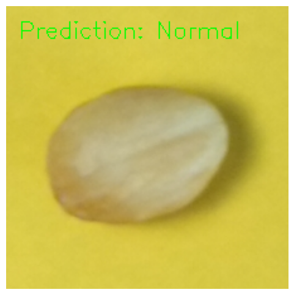

<div align="center">
  

  <h1>Industrial Anomaly Detection — Anomalib + OpenVINO</h1>

  <p>Unsupervised defect detection trained on <b>normal images only</b>, deployed through two inference backends: <b>OpenVINO</b> (optimised CPU) and <b>PyTorch</b>.</p>

  <p>
    
    
    
    
    
  </p>
</div>

---

## Overview

On a real production line, defects are rare and every defect looks different, so collecting enough labelled defect images is impractical. This project uses **unsupervised anomaly detection**: the model learns what a *good* product looks like, and anything that deviates is flagged as **Anomalous**.

Two models are trained on a hazelnut inspection dataset (normal vs. crack) and exported for deployment:

| Model | Approach | Params | Epochs | Deployment |
|---|---|---|---|---|
| **CFlow** | Conditional normalizing flow on CNN features | 236M | 25 | OpenVINO `.xml` (CPU-optimised) |
| **PaDiM** | Gaussian distribution of ResNet-18 patch features | 2.8M | 1 | PyTorch `.pt` |

<p align="center">
  
  <br><sub>CFlow running through OpenVINO on CPU</sub>
</p>

---

## Pipeline

```
dataset/
 ├── good/   ── train ──►  Anomalib model (CFlow / PaDiM)
 └── crack/  ── evaluate ──┘          │
                                   export
                      ┌───────────────┴───────────────┐
                      ▼                               ▼
               OpenVINO  model.xml              PyTorch  model.pt
                      │                               │
                      └──────────► infer.py ◄─────────┘
                                      │
                    anomaly score  →  NORMAL / ANOMALOUS  +  annotated image
```

Only `good/` images are used for training. `crack/` images are used only for evaluation, which is the core principle of unsupervised anomaly detection.

---

## Quick start

```bash
git clone https://github.com/eslamelmenyawy/anomaly-detector.git
cd anomaly-detector

conda create -n anomalib python=3.10 -y && conda activate anomalib
pip install torch torchvision --index-url https://download.pytorch.org/whl/cu121
pip install -r requirements.txt
```

Arrange your dataset like this (any product works, not just hazelnuts):

```
data/hazelnut_toy/
├── good/    ← normal images
└── crack/   ← defect images (optional, evaluation only)
```

### Train and export

```bash
# CFlow → OpenVINO
python src/train.py --model cflow --data-root data/hazelnut_toy --export openvino

# PaDiM → PyTorch (trains in seconds)
python src/train.py --model padim --data-root data/hazelnut_toy --export torch
```

### Run inference

```bash
# Single image or a whole folder; annotated results are written to outputs/
python src/infer.py --weights weights/cflow/weights/openvino/model.xml --source data/hazelnut_toy/crack

# Custom threshold (score > threshold = anomalous)
python src/infer.py --weights weights/padim/weights/torch/model.pt --source sample.jpg --threshold 0.4
```

`infer.py` picks the backend from the file extension, prints a score table with per-image latency, and saves annotated images plus heatmaps when the model provides them.

---

## Results

| Model | Image | Score | Threshold | Prediction |
|---|---|---|---|---|
| CFlow (OpenVINO) | `good/00.jpg` | 2.1502 | model default | ✅ Normal |
| PaDiM (PyTorch) | `good/15.jpg` | below threshold | 0.4 | ✅ Normal |
| PaDiM (PyTorch) | `crack/04.jpg` | 0.4988 | 0.4 | ❌ Anomalous |

PaDiM correctly flags the cracked hazelnut after a single epoch of distribution fitting.

**Hardware:** NVIDIA RTX 4060 Laptop GPU · PyTorch + CUDA 12.1 · Anomalib 1.0.1 · Windows 11

---

## Choosing a model

| | CFlow | PaDiM |
|---|---|---|
| Training cost | Slow (25 epochs, 236M params) | Fast (1 epoch, 2.8M params) |
| Strength | Higher accuracy on subtle defects | Fast prototyping, low-resource setups |
| Best deployment | OpenVINO on Intel CPUs / edge PCs | PyTorch, easy to embed in Python services |

---

## Project structure

```
anomaly-detector/
├── src/
│   ├── train.py                  # train + export (CLI)
│   └── infer.py                  # OpenVINO / PyTorch inference (CLI)
├── notebooks/
│   ├── cflow_openvino.ipynb      # CFlow exploration + OpenVINO export
│   └── padim_torch.ipynb         # PaDiM exploration + TorchInferencer
├── assets/
├── requirements.txt
├── LICENSE
└── README.md
```

---

## Roadmap

- [ ] Benchmark latency: PyTorch vs OpenVINO FP32 vs OpenVINO INT8 (NNCF)
- [ ] Pixel-level segmentation masks on MVTec AD
- [ ] FastAPI service with a `/predict` endpoint and Docker image
- [ ] Compare PatchCore and EfficientAD

---

## References

- [Anomalib](https://github.com/openvinotoolkit/anomalib) · [OpenVINO](https://github.com/openvinotoolkit/openvino)
- [CFlow-AD: Real-Time Unsupervised Anomaly Detection with Localization via Conditional Normalizing Flows](https://arxiv.org/abs/2107.12571)
- [PaDiM: A Patch Distribution Modeling Framework for Anomaly Detection and Localization](https://arxiv.org/abs/2011.08785)

---

<div align="center">
  Built by <b>Sam (Islam) Elmenyawy</b> · AI/ML Engineer, Computer Vision ·
  <a href="https://www.linkedin.com/in/islam-ahmed-00188015a/">LinkedIn</a> ·
  <a href="https://github.com/eslamelmenyawy">GitHub</a>
</div>
